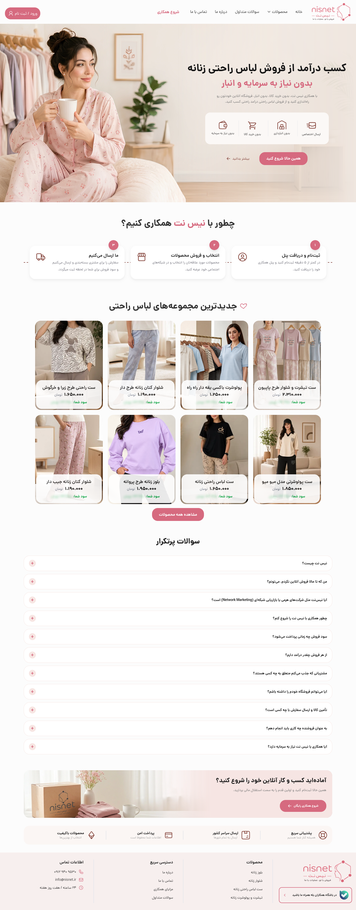
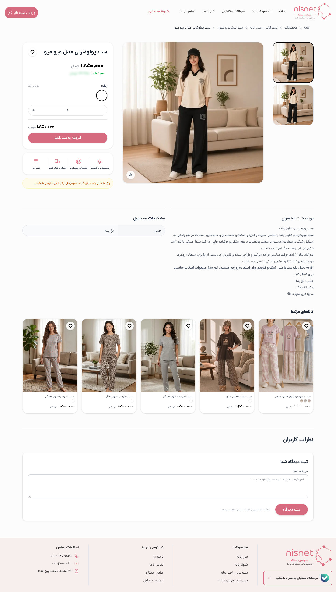
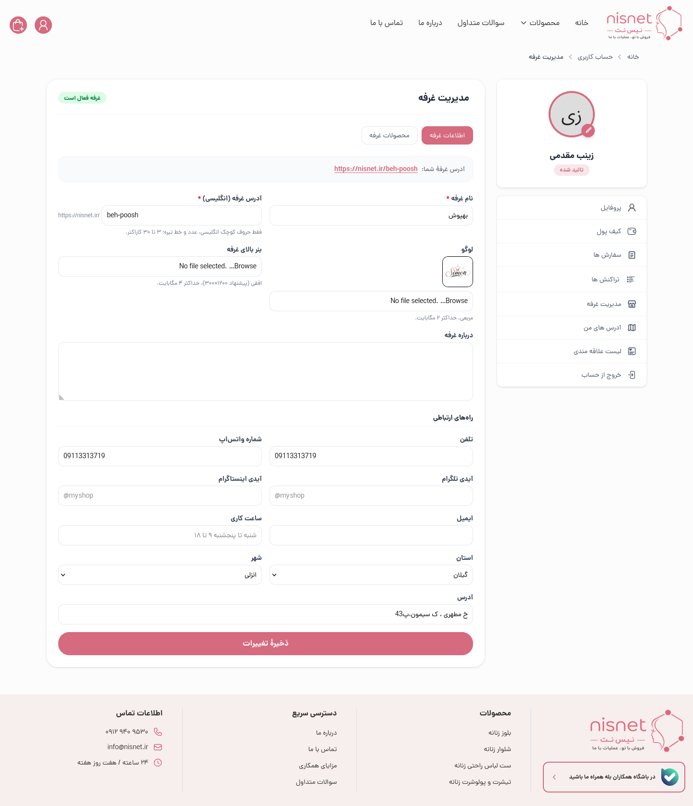

# nisNet

### E-commerce & Reseller Platform

**A production web application independently developed by Amir Abbas Afshar**

---

## Project Overview

**nisNet** is a production e-commerce platform built around a reseller/partner sales model. Partners can share products with their customers, set their own selling prices, and earn the difference through a wallet-based system. Partner levels are recalculated based on monthly sales.

This repository is a **public portfolio case study**, not the application's source code. It highlights the product, my development role, and selected engineering practices without exposing proprietary implementation details.

**Live product:** [nisnet.ir](https://nisnet.ir/)

## My Role

I independently developed nisNet from the ground up, working across the application lifecycle, including:

- Backend development and business logic
- Database design and data modeling
- Frontend implementation and user interfaces
- Integrations with external services
- Testing, deployment, and ongoing maintenance

## Product Capabilities

- **Product catalog & storefront:** Product browsing and online shopping experiences.
- **Partner-based selling:** Shareable product links and partner-specific pricing.
- **Orders & payments:** Order processing and payment workflows.
- **Wallet & earnings:** Tracking partner earnings and wallet transactions.
- **Partner levels:** Monthly, sales-based partner level calculation.
- **Administration:** Tools for managing the platform's day-to-day operations.

> Product features and availability may change as the live application evolves.

## Tech Stack

| Area | Technologies |
| --- | --- |
| Backend | PHP 8.4, Laravel 12 |
| Database | MySQL 8 |
| Frontend | Blade, JavaScript, Tailwind CSS 4, Vite 8 |
| Admin UI | Bootstrap 4 |
| Application tooling | Jetstream, Livewire 3 (profile features) |
| Quality | PHPUnit 11, Laravel Pint, Larastan |
| CI | GitHub Actions |

## Engineering Highlights

### Financial correctness

Wallet updates and other financial workflows are designed around database transactions, locking, and ledger-based recording. This helps maintain consistency when requests overlap or financial operations need to be reconciled.

### Maintainable backend structure

Core business rules are organized in service classes, with controllers kept focused on request handling. Authorization, validation, and domain logic have distinct responsibilities.

### Automated quality checks

The private application repository uses automated tests, formatting checks, static analysis, and continuous integration. Financial test coverage is included in CI with an enforced minimum threshold.

### Production ownership

Beyond feature development, the project includes deployment and rollback procedures, recurring maintenance tasks, and operational diagnostics.

## Product Screenshots

Screenshots will be added here from the live product. They will show only public pages or sanitized demo data.

## Project Status

**Live / Actively maintained** — [Visit nisNet](https://nisnet.ir/)

## Source Code

The application is a proprietary, production project. Its source code, private technical documentation, configuration, and business data are **not publicly available**. This repository contains presentation material only.

## Developer

**Amir Abbas Afshar** — Full-Stack Developer, Backend-Focused

[GitHub](https://github.com/AFEWSH) · [LinkedIn](https://www.linkedin.com/in/amir-abbas-afshar-5b3b72217/) · [Live Website](https://nisnet.ir/)
